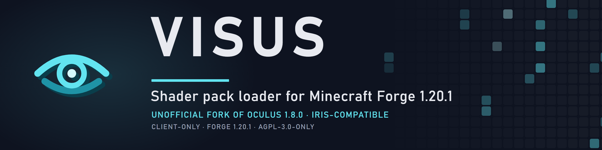
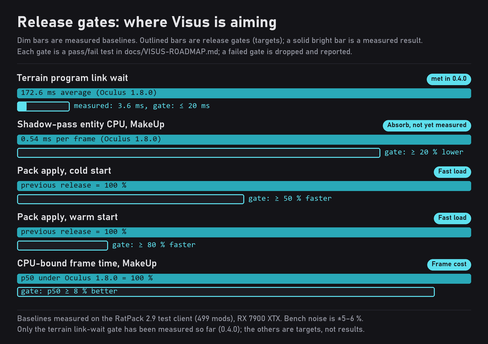

<p align="center">
  
</p>

# Visus

Visus is a shader pack loader for Minecraft 1.20.1 on Forge. It loads OptiFine, ShadersMod and Iris-format shader packs and is built as a drop-in replacement for Oculus 1.8.0, with the fixes, add-ons and speed-ups that RatPack-sized modpacks otherwise need five extra jars for.

> **Client-only and unofficial.** Visus is never required on a server. It is an independent project: it is **not** affiliated with, endorsed by, or supported by the Iris Shaders team, the Oculus maintainers, OptiFine, Mojang Studios, Microsoft or Minecraft Forge. It is a modified version of [Oculus](https://github.com/Asek3/Oculus) 1.8.0, itself an unofficial Forge port of [Iris](https://github.com/IrisShaders/Iris). Please do not report Visus problems to either upstream project.

## Features

This is the feature set Visus will have when its [roadmap](#roadmap) is complete. Items marked † are gated: each is measured against a pass/fail test, ships off by default, and is dropped and reported if it fails.

### Drop-in replacement

- **One jar, two mod ids.** Visus provides `visus` and an `oculus` compatibility alias (`provides = ["iris"]`), so mods that check for Oculus or depend on `oculus [1.8.0,)` keep working unchanged.
- **Frozen compatibility surface.** The 273 references into Oculus internals that mods in a 499-mod test pack depend on are recorded in [`abi/abi-freeze.txt`](abi/abi-freeze.txt) and enforced: `gradlew abiCheck` fails the build if any of them disappears.
- **Your packs and options carry over.** Shader packs, the `shaderpacks/` layout and the configuration file are the same as Oculus.
- **Byte-identical shader transformation.** The transformed GLSL is compared with Oculus 1.8.0 for every release, and a difference is allowed only when it is listed.

### Stability

- **Documented crash and corruption bugs are fixed,** each with a test that fails without the fix: translucency group nesting, NaN in smoothed values, degenerate tangents, infinite clip planes, pipeline swaps, depth formats and stale GL state caches.
- **No GL error storms.** GL debug messages are de-duplicated and rate-limited, and a pack that fails to compile falls back to vanilla rendering with an error toast instead of a broken frame.

### One jar instead of many
- **Included community fixes** Original Iris + Oculus has an absurd number of side-compatabiity/fix mods that Visus aims to integrate directly in for a number of contexts. 
- **Flywheel instancing under shader packs,** built in. Flywheel instances (Vanillin and Create 6) draw through the pack's programs in the main and shadow passes, with no separate Oculus Flywheel Compat jar.
- **Parallel shader compile service.** Every program is linked ahead of time on the driver's compiler threads or on hidden shared GL contexts, and each path switches itself off on drivers where it does not help.
- **Shadow skip list.** Sign text, glint, name tags and banner patterns are skipped in the shadow pass, where nothing shows them.
- **Fixes for GeckoLib animation state and particle draw order,** built in.
- **Add-on guard.** The jars this replaces are declared incompatible, so Forge stops with a message that names them instead of starting in a broken state.

### Extension API

- **`visus-api`, a formal MIT-licensed API** for LOD renderers and shader-aware mods, written from scratch and developed in lockstep with NeoVoxy. It carries the LOD program and pipeline hooks, and the bridge that lets Atmosphera and pack options cooperate.
- **A Distant Horizons adapter** over the same LOD API.

### Fast loading

- **Worker-pool shader transformation.** Preprocessing and transforming run on a pool, with one parser per thread.
- **Persistent on-disk caches.** A compressed cache of transformed shaders, plus a program-binary cache† with a self-check, an automatic off switch and a user toggle. Both have a size cap, least-recently-used eviction and `/visus cache clear`.

### Lower frame cost

- **Dirty-tracked and compiled uniforms,** so a uniform is only sent when it changed and custom uniforms are evaluated without a tree walk.
- **A flat-array sort-key batcher** in place of the translucency graph, with the correct first-in-first-out order for depthless and translucent types.
- **A shadow-pass entity budget** and pose reuse, plus skipped dead clears and flips in the render graph.
- **Zero steady-state allocation** on the render thread from Visus code.

### Modded shaders and pack authors

- **Modded core and post shaders under packs.** A transpiler routes a mod's `ShaderInstance` to the pack's albedo and gives other targets neutral defaults, with allow and deny lists and a debug overlay.
- **Stencil-aware depth** through texture views, with a copy fallback, so mods that need a stencil buffer work.
- **Pack-author tools:** a reference for every uniform, an error screen with line numbers mapped through `#include`, `KHR_debug` labels, a GPU pass-timing overlay, a render-target viewer and `/visus dump`.
- **Upstream Iris feature flags** that packs use, backported one at a time, each with a test pack.

### Experimental†

UBO uniforms, UNORM16 vertex data, a static shadow cache, GPU shadow culling, compute mipmaps, texel snapping, octahedral normals and transient target aliasing. Every item has a written gate and ships off by default.

### Compatibility

- **Atmosphera aware.** Visus carries the light mask and per-vertex hooks that [AtmospheraLib](https://github.com/SolarBiscuit/AtmospheraLib) uses, and its build refuses to package a Sodium terrain shader file that would disable them.
- **Embeddium-based terrain renderers** (Embeddium 0.3.1 or newer, or Xenon). **Not compatible with OptiFine.**

## Performance

Visus is built to a rule rather than to a headline number: **no frame-time regression of 3 % or more (p50 or p99) against Oculus 1.8.0 on any of five tested packs, at 2560x1440 and 1280x720.** On GPU-bound packs at high resolution, frame rate is expected to stay within noise. The gains Visus aims for are in pack load time, CPU-bound scenes, 1 % lows, allocation rate and crash count.

<p align="center">
  
</p>

The figures below are the project's own measurements, taken with the in-repo harness on the RatPack 2.9 test client (499 mods, Forge 47.4.23, Xenon 0.3.31, Java 25), an RX 7900 XTX, at 2560x1440. **Only AMD hardware has been tested.** The harness noise floor is ±5 to 6 %, so only differences of 8 to 10 % or more, from at least three alternating runs per side, are treated as real.

| Metric | Result |
|---|---|
| **Frame rate** | Parity with Oculus 1.8.0: Photon 1.3b base scene 151.2 against 151.4 fps and overview 171.9 against 172.7 fps (0.1.0); Complementary Unbound base 146.1 against 144.9 fps and overview 112.3 against 114.5 fps (0.2.1, within noise) |
| **Pack apply** | 66 programs linked in 1.3 s on first load and 0.9 to 1.1 s on reloads (0.4.0), against a baseline stall of about 45 to 77 s on AMD before parallel compilation |
| **Terrain link wait** | 3.6 ms average (0.4.0), against 172.6 ms on Oculus 1.8.0 and a gate of 20 ms or less: **met** |
| **Sync** | 0 GL debug messages over 15 pipeline rebuilds (0.3.0); the separate Flywheel add-on raised GL error 0x3F6 on every one |
| **Shadow-pass entity CPU** | 0.39 to 0.54 ms per frame on MakeUp, about 12 to 13 % of render-thread busy time on Oculus 1.8.0; gate: at least 20 % lower (not yet measured) |
| **Shader transformation** | Identical to Oculus 1.8.0 on every pack tested (Photon 1.3b: all 460 files, Flywheel programs included; Complementary Unbound r5.9.3: 225 programs) |

Pending gates: cold pack apply at least 50 % faster, or warm apply at least 80 % faster; on the CPU-bound pack (MakeUp), p50 frame time at least 8 % better or p99 at least 10 % better with no regression on GPU-bound packs.

## Roadmap

| Release | Theme | Content |
|---|---|---|
| 0.1.x | Baseline | Fork, identity, licence, ABI census, golden references |
| 0.2.x | Stability | Documented crash and corruption fixes, GL error de-duplication, safe fallback |
| 0.3.0 to 0.4.0 | Absorb (**current: 0.4.0**) | Built-in Flywheel, parallel compile service, shadow skip list, GeckoLib and particle fixes, add-on guard |
| Next | APIs | `visus-api` (MIT), LOD API, NeoVoxy, Atmosphera and Distant Horizons bridges |
| | Fast load | Worker-pool transformation, disk caches |
| | Frame cost | Uniform and batching work, shadow budget |
| | Mod shaders | Mod `ShaderInstance` support, stencil-aware depth |
| | Pack SDK | Pack-author tools and upstream feature flags |
| | Experimental | Gated, off-by-default items |

Dates and exact version numbers are not promised: the version follows the rules in [`CHANGELOG.md`](CHANGELOG.md), and a release that changes 500 lines or more starts a new minor version. The full release plan, with every gate, is [`docs/VISUS-ROADMAP.md`](docs/VISUS-ROADMAP.md). Version 1.0.0 is reserved for when the project is declared complete.

## Requirements

- Minecraft **1.20.1** with Forge **47.x** (built against 47.1.105; tested on 47.4.23)
- Java **17** or newer
- An Embeddium-based terrain renderer: Embeddium 0.3.1 or newer (built against 0.3.14), or Xenon (tested with 0.3.31)

## Installation

1. Remove Oculus from your `mods` folder. Visus and Oculus both register the mod id `oculus`, so they cannot be installed together.
2. Remove Oculus Flywheel Compat (`irisflw`), Oculus Particle Fix and GeckoLibOculusCompat if you have them. Visus does their jobs and Forge stops at loading with a message naming any that remain.
3. Place `visus-1.20.1-<version>.jar` in `mods`.
4. Place shader packs in `shaderpacks/` as before.

## Building

```bash
./gradlew build
```

The build uses Architectury Loom, requires a JDK 17 and writes `build/libs/visus-1.20.1-<version>.jar`. `gradlew build` also runs `abiCheck` and `checkForbiddenResources`.

## Licence and attribution

- The Visus mod as a whole is licensed under the **GNU Affero General Public License v3.0 only** ([`LICENSE`](LICENSE)). This follows from the bundled [glsl-transformer](https://github.com/IrisShaders/glsl-transformer) library, which is AGPL-3.0.
- Files that originate from Oculus and Iris remain available under the **GNU Lesser General Public License v3.0 only** ([`COPYING.LESSER`](COPYING.LESSER), [`COPYING.GPL-3.0`](COPYING.GPL-3.0)).
- The Flywheel integration is adapted from Iris Flywheel Compat 2.0.5 (Copyright (c) 2022 Red Face, MIT), and the compile service is ported from RatOptimization's `oculus_shaders` module (Copyright (c) 2026 SolarBiscuit, MIT). Their notices are kept in [`NOTICE`](NOTICE) and in the jar under `META-INF/visus/`.
- The planned `visus-api` module is written from scratch and is licensed under the **MIT** licence. Mods that use only `visus-api` are not bound by the AGPL.
- Under AGPL-3.0 section 7(b), copies and modified versions must keep [`NOTICE`](NOTICE) and the attribution **"Based on Visus by SolarBiscuit"** in their legal notices and project page.

Visus is built on the work of the Iris authors (coderbot, IMS212, Justsnoopy30, FoundationGames and contributors) and the Oculus authors (NanoLive, dima_dencep and contributors). Bundled third-party libraries and their licences are listed in [`NOTICE`](NOTICE).

## Reporting issues

Issues belong in the [Visus issue tracker](https://github.com/SolarBiscuit/Visus/issues). Please include the Visus version, your shader pack and its options, and `latest.log`.
